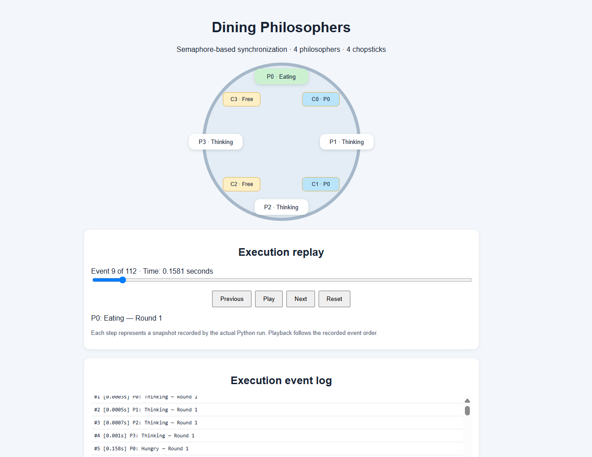
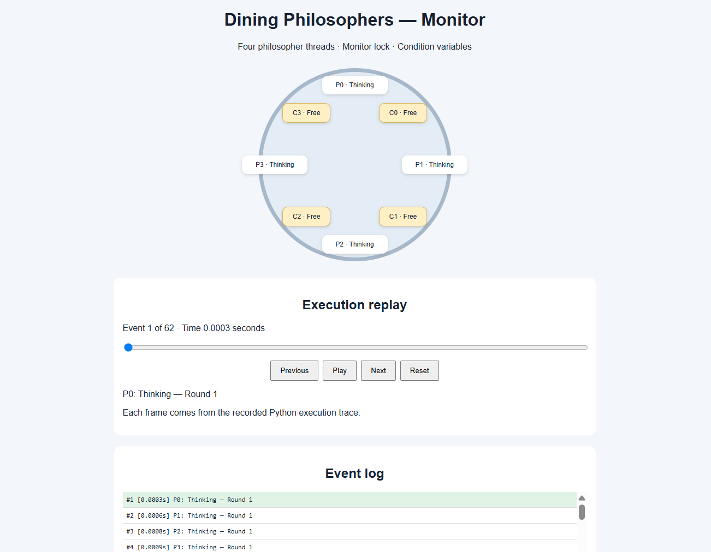
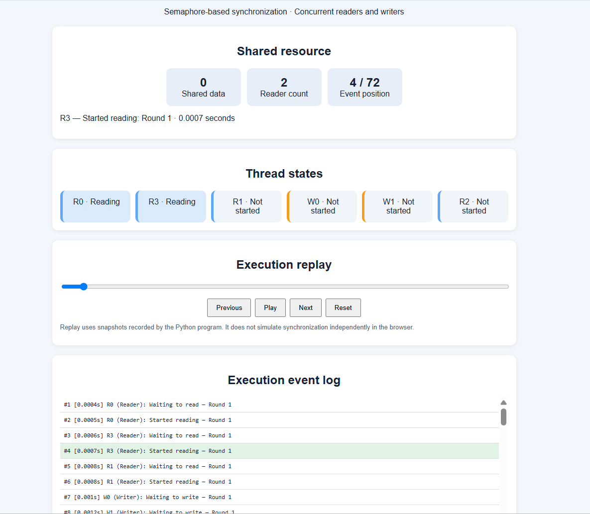
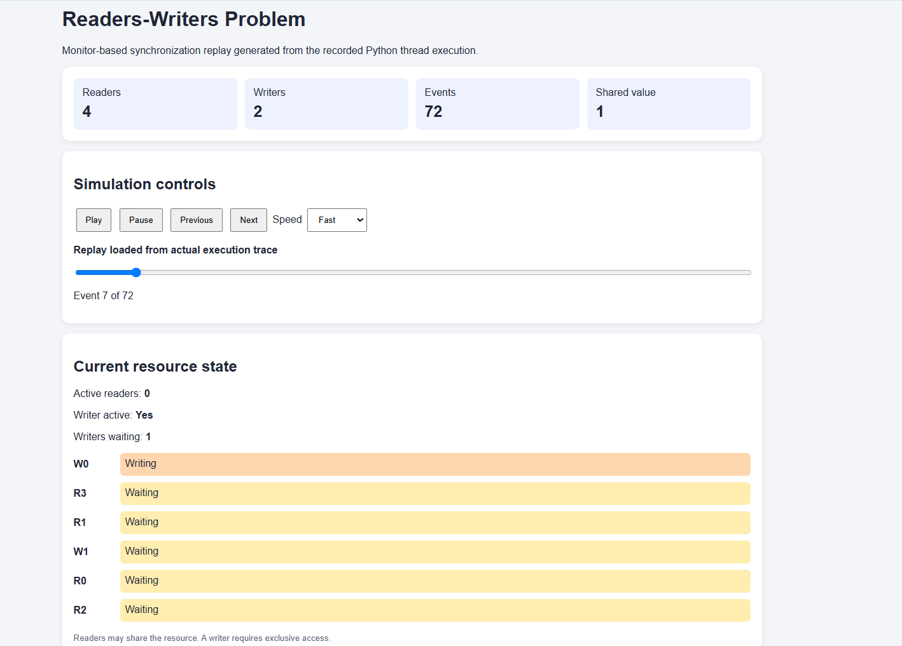

# Operating Systems Programming Assignment

## AI-Assisted Synchronization Algorithms with Program-Generated HTML Simulation

**Subject:** Operating Systems

**Student Name:** Ishani Poojary

**USN:** NNM24IS094

**Programming Language:** Python

---

## 1. Introduction

Process synchronization is an important concept in operating systems. When multiple threads execute at the same time and access shared resources, synchronization is required to avoid conflicts and maintain correct execution.

This assignment implements two classical synchronization problems: the Readers-Writers problem and the Dining Philosophers problem. Both problems are implemented using two approaches: semaphores and monitors.

The assignment also includes HTML simulations generated using execution data collected from the programs. These simulations help visualize thread states and understand how synchronization takes place during execution.

## 2. Objectives

The main objectives of this assignment are:

- To understand process synchronization using semaphores and monitors.
- To implement the Readers-Writers problem using both approaches.
- To implement the Dining Philosophers problem for four philosophers using both approaches.
- To understand mutual exclusion, race conditions, deadlock, and starvation.
- To record execution events and use them to generate HTML simulations.
- To test the implementations and document the results.

## 3. Technologies Used

- **Python:** Used to implement the synchronization algorithms and concurrent threads.
- **Threading module:** Used to create and coordinate threads.
- **Semaphores, locks, and condition variables:** Used to control access to shared resources.
- **JSON:** Used to store execution events and state information.
- **HTML, CSS, and JavaScript:** Used to display the execution traces through browser-based simulations.
- **Visual Studio Code:** Used for development and testing.

## 4. Implementation of Synchronization Algorithms

### 4.1 Readers-Writers Problem Using Semaphores

The Readers-Writers problem deals with multiple threads accessing a shared resource. Several readers can read the resource at the same time, but a writer must have exclusive access while modifying it.

In this implementation, four reader threads and two writer threads are used. Each thread performs three rounds of operations.

Semaphores are used to coordinate access to the shared resource. A reader can enter the reading section when writing is not in progress. Writers obtain exclusive access before modifying the shared value.

The program records events during execution and saves them in a JSON trace file. This trace is later used to generate the HTML simulation.

### 4.2 Readers-Writers Problem Using Monitors

The monitor-based implementation solves the same problem using a monitor-style synchronization mechanism.

Python does not provide a dedicated monitor construct, so locks and condition variables can be used to build an equivalent mechanism. The synchronization logic controls when readers and writers can enter their respective critical sections.

The implementation uses four readers and two writers, with three rounds per thread. The program records execution events so that the behaviour can be displayed in an HTML simulation.

### 4.3 Dining Philosophers Problem Using Semaphores

The Dining Philosophers problem represents a situation in which several threads compete for shared resources. Four philosophers sit around a table, with four chopsticks available. Each philosopher needs two neighbouring chopsticks to eat.

In the semaphore-based implementation, each chopstick is protected by a binary semaphore. A counting semaphore initialized to three limits the number of philosophers allowed to compete for chopsticks simultaneously.

This restriction helps prevent deadlock by ensuring that all four philosophers cannot simultaneously hold one chopstick while waiting for another. Each philosopher completes three eating rounds.

The program records state changes and saves them to a JSON file, which is used to generate the HTML simulation.

### 4.4 Dining Philosophers Problem Using Monitors

The monitor-based implementation coordinates the four philosophers using shared state and monitor-style synchronization.

A philosopher's state changes according to the actions performed, such as thinking, becoming hungry, waiting for resources, and eating. The monitor controls access to shared state and coordinates waiting philosophers through condition variables.

The implementation records execution events so that the generated HTML simulation can display how the philosophers progress through their states.

## 5. Execution Trace and HTML Simulation

Each synchronization program records events during execution. These events contain information about the actions performed by threads and their states.

The recorded events are stored in JSON files. Separate HTML generator scripts read the corresponding JSON files and use the recorded data to create browser-viewable simulations.

The project contains four HTML simulations:

1. Dining Philosophers using semaphores.
2. Dining Philosophers using monitors.
3. Readers-Writers using semaphores.
4. Readers-Writers using monitors.

The simulations allow the execution sequence to be viewed in a more understandable format. They help demonstrate how threads change states and how synchronization controls access to shared resources.

The HTML files are generated using the generator scripts and the execution traces produced by the programs. Therefore, the visualizations are connected to the recorded program execution rather than being independent animations.

## 6. Testing and Verification

The implementations were executed to check their behaviour and generate the corresponding execution traces and HTML files.

### 6.1 Dining Philosophers

For both implementations, four philosophers were used, with three eating rounds per philosopher. The expected total was twelve completed eating rounds.

Verification scripts checked the recorded traces and the number of completed rounds. The recorded-trace checks passed for both implementations.

### 6.2 Readers-Writers

For both implementations, four readers and two writers were used, with three rounds per thread.

The expected number of reading rounds was twelve, and the expected number of writing rounds was six. The recorded traces contained 72 events for each implementation, and the final shared value was six.

Verification scripts checked the access counts and the recorded states for conflicts between readers and writers. The checks passed for both implementations.

### 6.3 Limitations of Testing

The verification scripts check the recorded execution data and selected synchronization conditions. They do not prove that every possible thread schedule is correct.

The results therefore provide evidence that the tested executions behaved as expected, while further testing and code review are needed to assess correctness under other possible schedules.

## 7. Comparison Between Semaphores and Monitors

Semaphores and monitors are synchronization mechanisms used to coordinate concurrent threads and protect shared resources.

### Semaphores
- **Basic mechanism:** Uses wait and signal operations.
- **Resource access:** Controlled through semaphore operations.
- **Mutual exclusion:** Can be implemented using binary semaphores.
- **Waiting:** Threads may block when a semaphore is unavailable.
- **Implementation in Python:** Uses semaphore objects from the threading module.
- **Main consideration:** Incorrect semaphore operations can cause synchronization errors.

### Monitors
- **Basic mechanism:** Uses a monitor-style abstraction with locks and condition variables.
- **Resource access:** Controlled through monitor methods and shared state.
- **Mutual exclusion:** Provided through controlled access to monitor operations.
- **Waiting:** Threads may wait on condition variables.
- **Implementation in Python:** Can be built using locks and condition variables.
- **Main consideration:** Incorrect condition checks or signalling can cause synchronization errors.

Both approaches can solve synchronization problems when implemented correctly. The main difference is how the synchronization rules and shared-resource access are organized.

## 8. Synchronization Issues

### 8.1 Race Conditions

A race condition occurs when the result of a program depends on the timing of concurrent operations on shared data. Synchronization mechanisms help control access to shared resources and prevent conflicting operations.

### 8.2 Mutual Exclusion

Mutual exclusion ensures that only one thread at a time enters a section that requires exclusive access. In the Readers-Writers problem, writers require exclusive access while modifying shared data.

### 8.3 Deadlock

Deadlock occurs when threads wait indefinitely for resources held by one another.

In the Dining Philosophers semaphore implementation, limiting the number of philosophers competing for chopsticks to three helps prevent the situation in which all four philosophers hold one chopstick and wait for another.

The monitor-based solution coordinates philosopher states and allows philosophers to wait until the required resources are available.

### 8.4 Starvation

Starvation occurs when a thread waits for an excessively long time because other threads repeatedly get access to a resource first.

Preventing deadlock does not automatically guarantee freedom from starvation. Fairness depends on the synchronization policy and the order in which waiting threads are allowed to proceed.

## 9. Conclusion

This assignment provided practical experience with process synchronization in operating systems. The Readers-Writers and Dining Philosophers problems were implemented using semaphores and monitor-style synchronization.

Execution events were recorded in JSON files and used to generate four HTML simulations. Verification scripts were also used to check the recorded execution data and expected operation counts.

The project helped demonstrate the importance of synchronization when multiple threads share resources. It also provided an opportunity to compare semaphore-based and monitor-based approaches and examine race conditions, mutual exclusion, deadlock, and starvation.

## 10. Use of AI Tools

ChatGPT was used during the development of this assignment to understand synchronization concepts, plan the implementations, troubleshoot errors, create verification scripts, and organize the project documentation.

The suggestions were reviewed and tested during development. File paths were adjusted when the project was organized into separate folders, and the programs were executed again to check that the trace files and HTML simulations were generated correctly.

One limitation identified during development was that passing verification scripts does not guarantee correctness for every possible thread schedule. The verification scripts check recorded events and selected synchronization conditions, so additional testing and code review are still important.

## 11. Academic Integrity Declaration

I declare that I have reviewed and tested the submitted programs and have documented the AI tools and external resources used during development. I am responsible for understanding the synchronization logic, execution traces, HTML simulations, and modifications made to the code. I will explain the implementations and their limitations during evaluation.

## 12. Screenshots of HTML Simulations

The following screenshots show the browser-based simulations generated from the execution traces of the four synchronization implementations.

### 12.1 Dining Philosophers Using Semaphores

The screenshot shows the Dining Philosophers simulation using semaphores.

### 12.2 Dining Philosophers Using Monitors

The screenshot shows the Dining Philosophers simulation using monitor-style synchronization.

### 12.3 Readers-Writers Using Semaphores

The screenshot shows the Readers-Writers simulation using semaphores.

### 12.4 Readers-Writers Using Monitors

The screenshot shows the Readers-Writers simulation using monitor-style synchronization.

## 13. References

1. Silberschatz, A., Galvin, P. B., and Gagne, G. *Operating System Concepts*. Wiley.

2. Python Software Foundation. *threading — Thread-based parallelism*. https://docs.python.org/3/library/threading.html

3. Python Software Foundation. *threading — Semaphore Objects*. https://docs.python.org/3/library/threading.html#semaphore-objects

4. Python Software Foundation. *threading — Condition Objects*. https://docs.python.org/3/library/threading.html#condition-objects

5. MDN Web Docs. *HTML: HyperText Markup Language*. https://developer.mozilla.org/en-US/docs/Web/HTML

6. MDN Web Docs. *CSS: Cascading Style Sheets*. https://developer.mozilla.org/en-US/docs/Web/CSS

7. MDN Web Docs. *JavaScript*. https://developer.mozilla.org/en-US/docs/Web/JavaScript

8. OpenAI. *ChatGPT*. https://chatgpt.com/
